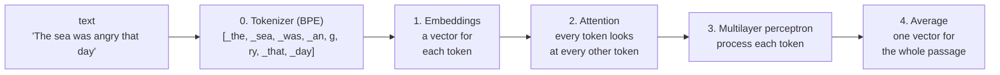

# TeenyTinyEmbedder

This sketch trains a tiny embedding model from scratch in your browser with TensorFlow.js.

It's built from the same parts as [TeenyTinyGPT](https://github.com/Programming-from-A-to-Z/TeenyTinyGPT.js) but works differently. TeenyTinyGPT predicts the next token. TeenyTinyEmbedder turns a block of text of variable length into one list of numbers (an **embedding**!), so that text that goes together ends up near each other in the "embedding space."



In `setup()`, the sketch trains the tokenizer and turns the text into tokens. Then every frame of `draw()` is one step of training the embeddings model. You'll see the loss and the results for a search, which updates every 100 steps (or when you press enter). Open the console to see the tokenizer's first new tokens and an example training pair every 100 steps.

## 0. Tokens: Byte Pair Encoding

First, the sketch _learns_ a vocabulary of tokens (1,000) from the text with **byte pair encoding** (BPE). This is the same idea GPT models use, and the same `bpe.js` as the [Byte Pair Encoding](https://github.com/Programming-from-A-to-Z/BPE-Tokenizer) example and [TeenyTinyGPT](https://github.com/Programming-from-A-to-Z/TeenyTinyGPT.js).

One difference here is that the sketch cleans the text to include lowercase letters only, with a space in front of every word (no punctuation). This simplifies the text for the model to predict embeddings and it's fine to do so because the embedding model only reads text and it never has to write any text. The embeddings model [all-MiniLM-L6-v2](https://huggingface.co/sentence-transformers/all-MiniLM-L6-v2) lowercases everything too.

## 1. Training pairs of "similar" text

What does it mean for two passages of text to be "similar"? This is the most important part of training an embedding model! Many embedding models use datasets of text pairs (Reddit post and comment, WikiAnswers duplicate questions, and more). Here, pairs are made with neighboring passages of text. First, a random passage (the "anchor") is picked and paired with the passage that comes right after it (the "partner").

```js
let start = floor(random(data.length - anchorLength - partnerLength));
let middle = start + anchorLength;
anchors.push(data.slice(start, middle));
partners.push(data.slice(middle, middle + partnerLength));
```

With TeenyTinyGPT, the target is the input shifted by one token and the model learns "what comes next?" one token at a time. TeenyTinyEmbedder learns to predict that two neighboring passages are similar. It's the idea behind word2vec ("You shall know a word by the company it keeps," —J.R. Firth).

The lengths are random, from 2 to 16 tokens, so the model learns to compare passages of text with variable lengths.

## 2. Embeddings (and no positions!)

Just like TeenyTinyGPT, every token in the vocabulary gets a vector of 64 numbers (initialized at random).

```js
this.tokenEmbedding = tf.layers.embedding({ inputDim: vocabSize, outputDim: embedSize });
```

For this implementation, however, there's no position embedding! Most embedding models do have positions, since word order matters ("dog bites man" vs. "man bites dog"). But here, every pair in a training batch is the same length, so the model never learns to ignore length. With positions, all 3-token lines get a similar "I am 3 tokens long" signature, and short queries match lines of the same length instead of lines about the same thing. The embedder also averages all the token vectors together (see step 4 below), which mostly erases the word order anyway. So here, the model sees text as a "bag of tokens." The tokens still look at each other with attention!

## 3. Attention without a mask

Attention is the same query, key, and value as TeenyTinyGPT, but there is no mask!

```js
let scores = tf.matMul(q, k, false, true);
scores = scores.div(Math.sqrt(this.embedSize));
// No mask! This model can look forward and backward
let weights = tf.softmax(scores);
```

TeenyTinyGPT's mask stops each token from seeing the future, because the future is the answer it's trying to predict. An embedding model reads the whole passage at once, and there's nothing to predict. Every token can look at every other token, before and after it. GPT is called a **decoder** model, and a model that sees in both directions (like BERT and most embedding models) is called an **encoder**.

The residual connections and the multilayer perceptron are exactly the same as TeenyTinyGPT.

## 4. One vector for the whole passage

TeenyTinyGPT ends with one more dense layer that gives every position a score for every token. TeenyTinyEmbedder ends by averaging every token's vector into one vector. This is called **mean pooling**, and it's what all-MiniLM-L6-v2 does too.

```js
let average = x.mean(1); // [batch, embedSize]
return average.div(average.norm('euclidean', 1, true));
```

The second line scales each vector so its length is 1. Cosine similarity is the standard way to measure similarity between two vectors, and if both vectors have a length of 1, their dot product _is_ their cosine similarity.

## 5. Loss: find your partner

Each training step, `train()` turns the 32 anchors and the 32 partners into embeddings with `predict()`:

```js
let a = this.predict(anchors); // [32, 64]: an embedding for each anchor
let b = this.predict(partners); // [32, 64]: an embedding for each partner
```

`a` has 32 rows, one 64-number embedding for each anchor, and `b` is the same for the partners. Row 0 of `b` is the partner of row 0 of `a`, row 1 goes with row 1, and so on.

Next, compare every anchor with every partner. Every embedding has a length of 1 (see step 4), so the dot product of two embeddings is their cosine similarity. One matrix multiplication does all 32 × 32 = 1,024 dot products at once:

```js
let similarity = tf.matMul(a, b, false, true); // [32, 32]
```

The `false, true` means "transpose `b` first" (the same trick as attention in TeenyTinyGPT), so `[32, 64] × [64, 32]` gives `[32, 32]`. The number in row _i_, column _j_ is the dot product of anchor _i_ and partner _j_.

Then we need to compare these scores to a matrix of "correct answers". You can think of each row as a multiple-choice question: which slot is my partner? The right answers are all on the diagonal! So the answer key is a grid with 1s on the diagonal and 0s everywhere else. This is known as the **identity matrix**. `tf.eye()` makes one (it's named for _I_, the math symbol for the identity matrix):

```js
// 32x32 identity matrix
let answers = tf.eye(anchors.shape[0]);
// For 3 pairs it would be:
// [1, 0, 0]
// [0, 1, 0]
// [0, 0, 1]
```

Finally the loss is computed with `softmaxCrossEntropy()`. For each row, softmax turns the scores into guesses that add up to 1. With 3 partners, the guesses for anchor 0 might be 0.98 for partner 0, 0.00 for partner 1, and 0.02 for partner 2. The loss only looks at the guess for the right partner: it's −log(guess), so a guess of 0.98 gives a loss of 0.02, and a guess of 0.1 gives a loss of 2.3. Then it's averaged over all the rows. TeenyTinyGPT picks the right next token out of 500, and TeenyTinyEmbedder picks the right partner out of 32.

```js
return tf.losses.softmaxCrossEntropy(answers, similarity.mul(20));
```

Cosine similarity only goes from −1 to 1, which is too close together for softmax, so the scores are multiplied by 20 first. Backpropagation then changes the weights so that next time, the right partners score higher and the others lower. Pulling the right partner closer means pushing the other 31 away. They're called "in-batch negatives."

This is how all-MiniLM-L6-v2 was trained! From its model card: "We then apply the cross entropy loss by comparing with true pairs." (It used batches of 1,024 pairs and over a billion pairs in all.)

Guessing evenly among the 32 partners gives a loss of −log(1/32) ≈ 3.47. The loss usually starts higher than that, because random embeddings make confident wrong guesses. It drops to about 3.4 quickly, then slowly works its way down to about 2.4 after a few thousand steps.

## 6. Query

Now we can commpare a query's embedding with embeddings for a dataset.

```js
let query = embedder.embeddings([tokenizer.encode(clean(queryInput.value()))])[0];
for (let line of lines) {
  line.score = dotProduct(query, line.embedding);
}
```

Notice how when the training starts, the search query results in mostly lines that match words. This is because lines that have the same tokens have some of the same embeddings. After a while, the model finds finds lines that are related but don't share any words! For example "bees and flowers" might match to "With only butterflies to brood" and searching "a bird sings" would find "Oh, some wise man from the skies!".

The model only learns which words show up near each other in this source text, about 30,000 words of Dickinson. It doesn't know what an ocean is!

## TeenyTinyEmbedder vs. all-MiniLM-L6-v2

|                    | TeenyTinyEmbedder                | [all-MiniLM-L6-v2](https://huggingface.co/sentence-transformers/all-MiniLM-L6-v2) (2021)                 |
| ------------------ | -------------------------------- | -------------------------------------------------------------------------------------------------------- |
| Tokens             | 1,000 (BPE, lowercase)           | 30,522 (WordPiece, lowercase)                                                                            |
| Numbers per token  | 64                               | 384                                                                                                      |
| Attention heads    | 1                                | 12                                                                                                       |
| Transformer blocks | 1                                | 6                                                                                                        |
| Parameters         | ~110 thousand                    | ~22 million                                                                                              |
| Training pairs     | Neighboring passages in one text | Over 1 billion: Reddit comments and replies, questions and answers, paper titles and abstracts, and more |
| Batch size         | 32                               | 1,024                                                                                                    |

all-MiniLM-L6-v2 also started from a model that had already been pre-trained on lots of text, before any of its pair training.

## Things to try

1. **Change what counts as a pair!!!**
2. Try `data/shakespeare.txt` or your own text (at least 100KB).
3. Try a different `vocabSize`.
4. Put the position embedding back.
5. Try a bigger `batchSize`. Each anchor then has more partners to choose from.
6. Take out `clean()`, so the tokenizer keeps capital letters and punctuation.

## References

- 🔗 [all-MiniLM-L6-v2](https://huggingface.co/sentence-transformers/all-MiniLM-L6-v2)
- 🔗 [Byte-pair encoding](https://huggingface.co/learn/llm-course/chapter6/5)
- 🎥 [Let's build the GPT Tokenizer](https://www.youtube.com/watch?v=zduSFxRajkE) by Andrej Karpathy
- 📚 [Neural Machine Translation of Rare Words with Subword Units](https://arxiv.org/abs/1508.07909) (Sennrich et al., 2016)
- 📚 [Sentence-BERT](https://arxiv.org/abs/1908.10084) (Reimers and Gurevych, 2019)
